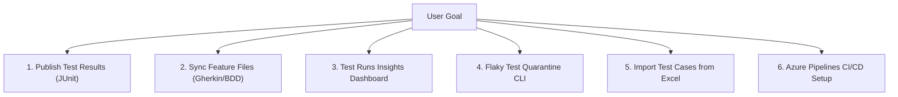

# ADO Test Reporter

A lightweight, enterprise-ready service that bridges automated test execution and Azure DevOps (ADO) Test Plans. It turns ephemeral JUnit XML results into persistent, traceable data—linking Test Cases, Plans, Suites, Defects, and Requirements automatically.

---

## 🤖 AI Agent & Developer Setup Playbook

> [!NOTE]
> **Instructions for AI Agents (Cursor, Claude, Copilot, Antigravity, etc.):**
> When a user asks you to help them set up or use this repository, follow this structured, interactive playbook. Ask the user clarifying questions step-by-step, verify prerequisites before running commands, and adhere strictly to the credential security protocol below.

---

### 🛡️ Credential Security & Safety Protocol (Read First)
1. **Never ask the user to paste secrets into chat:** Do not prompt the user to output raw tokens, passwords, or personal access tokens (PAT) in conversation messages or logs.
2. **Local runs (`.env`):** Direct the user to create a local `.env` file from `.env.example`. The `.env` file is included in `.gitignore` and must never be committed.
3. **Pipeline runs (`$(System.AccessToken)`):** For Azure Pipelines, configure the pipeline to use the system token or Azure Service Principal. Ensure the build service account has permission to contribute to Test Runs and Work Items.
4. **Minimal Required Scopes for ADO PAT:**
   | Scope | Permission Level | Reason |
   |---|---|---|
   | **Test Management** | `Read & Write` | Create/update Test Runs, Test Points, and publish results |
   | **Work Items** | `Read & Write` | Create, search, update Test Cases and Failure Tasks/Bugs |
   | **Project & Team** | `Read` | Resolve project metadata and team configuration |
   | **Build** *(optional)* | `Read` | Retrieve build metadata if linking runs to pipeline builds |

---

### 📋 Phase 1: Environment & Dependency Verification

Before configuring ADO or running jobs, verify the local development environment:

1. **Check Node.js (requires Node 18+ or 20+):**
   ```bash
   node -v
   ```
2. **Install project dependencies:**
   ```bash
   npm install
   ```
3. **Verify TypeScript compilation:**
   ```bash
   npm run typecheck
   ```
4. **Run existing unit test suite to verify baseline integrity:**
   ```bash
   npm test
   ```

---

### ⚙️ Phase 2: Configuration & Credentials Setup

#### Step 1: Initialize `.env`
Instruct the user (or create) the `.env` file from `.env.example`:
```bash
cp .env.example .env
```

#### Step 2: Configure Environment Variables
Prompt the user for their Azure DevOps organization details and update `.env`:

```ini
# Required: Azure DevOps Organization & Project
ADO_ORG_URL=https://dev.azure.com/YOUR_ORGANIZATION
ADO_PROJECT=YOUR_PROJECT_NAME
ADO_TOKEN=YOUR_PERSONAL_ACCESS_TOKEN

# Recommended Defaults (Safe Onboarding)
ADO_DEFECT_TYPE=Task                # Work item type for failures ("Task" or "Bug")
CREATE_FAILURE_TASKS=true           # Automatically create defect tickets on test failures
ADO_AUTO_CLOSE_ON_PASS=true         # Automatically close open defect tasks when test passes
ADO_AUTO_CREATE_TEST_CASES=true     # Auto-create Test Cases if ID not found in ADO
ADO_AUTO_CREATE_PLAN=true           # Auto-create Test Plan if target plan doesn't exist
ADO_AUTO_CREATE_SUITE=true          # Auto-create Test Suite if target suite doesn't exist
ADO_FALLBACK_TO_NAME_SEARCH=true    # Search by test title if no ID pattern (e.g. _TC123) is found
ADO_DETECT_FLAKY_TESTS=false        # Set to true to inspect historical failure rates (last 7 days)
```

---

### 🚀 Phase 3: Interactive Workflows & Agent Runbooks

Walk the user through the relevant workflow based on their goal:



---

#### 📦 Workflow 1: Publish JUnit Results to Azure Test Plans

Use this workflow to parse JUnit XML, map tests to Test Cases, publish a Test Run, and auto-generate defect tasks for failures.

**Agent Interactive Questions to Ask User:**
> 1. *"Do you have a JUnit XML file ready (e.g., from Jest, PyTest, Playwright, Cypress), or should we test with the sample file `src/results.xml`?"*
> 2. *"What are your desired Test Plan and Test Suite names in Azure DevOps (or should we use default smoke test names)?"*
> 3. *"Would you like failures logged as `Task` or `Bug` in your backlog?"*

**Execution Commands:**
```bash
# 1. Smoke test verification using the bundled sample results
npm start -- \
  --junit-file src/results.xml \
  --plan-name "Smoke Test Plan" \
  --suite-name "Automated Regression" \
  --attach-results

# 2. Dynamic release plan (creates a new plan automatically for the run)
npm start -- \
  --junit-file path/to/your/junit.xml \
  --plan-name auto-generate \
  --suite-name "Sprint Execution" \
  --attach-results

# 3. Publish results and generate an instant HTML dashboard snapshot
npm start -- \
  --junit-file path/to/your/junit.xml \
  --plan-name "Sprint 42" \
  --suite-name "E2E Tests" \
  --generate-dashboard \
  --dashboard-days 30 \
  --dashboard-output reports/run-dashboard.html
```

---

#### 🥒 Workflow 2: Sync Gherkin Feature Files to ADO Test Cases

Use this workflow to convert `.feature` files in Git into living documentation in Azure Test Plans.

**Agent Interactive Questions to Ask User:**
> 1. *"Where are your feature files located (default is `features/**/*.feature`)?"*
> 2. *"Are your scenarios tagged with `@TC_<id>` (e.g., `@TC_1015`) to update existing Test Cases, or should the tool auto-provision new ones?"*

**Step Mapping Logic:**
- `Given` / `When` $\rightarrow$ **Action** step in ADO Test Case
- `Then` $\rightarrow$ **Expected Result** step in ADO Test Case
- Requirement tags (e.g., `@Story123` or `@AB#456`) $\rightarrow$ Auto-linked to Requirement work item

**Execution Command:**
```bash
npm run sync-features
```

---

#### 📊 Workflow 3: ADO Test Runs Insights Dashboard

Use this workflow to analyze automation execution share, flaky test oscillation, failure signatures (`ErrorHash`), and execution duration.

**Agent Interactive Questions to Ask User:**
> 1. *"Do you want to run the live local server to explore the dashboard in your browser, or export a self-contained static report (HTML/CSV/Markdown)?"*
> 2. *"What date range or lookback window (e.g., last 30 days) would you like to analyze?"*

**Execution Commands:**
```bash
# Option A: Start the interactive live server (persists cache to .cache/ado-dashboard-cache.json)
npm run dashboard -- --days 30 --port 4200

# Option B: Export a self-contained standalone HTML report for stakeholders
npm run dashboard:export -- \
  --start-date 2026-10-01 \
  --end-date 2026-11-01 \
  --format html \
  --output reports/ado-test-runs-dashboard.html

# Option C: Export a CSV summary for spreadsheet / PowerBI analysis
npm run dashboard:export -- \
  --start-date 2026-10-01 \
  --end-date 2026-11-01 \
  --format csv \
  --output reports/ado-test-runs.csv
```

---

#### 🛡️ Workflow 4: Flaky Test Quarantine CLI

Use this workflow to quarantine known flaky tests in `quarantine.json` so they do not block CI pipelines while under repair, and track their consecutive passes toward graduation.

**Agent Interactive Questions to Ask User:**
> 1. *"Do you want to inspect existing quarantined tests, quarantine a new failing test, or graduate/remove a stabilized test?"*

**Execution Commands:**
```bash
# List all actively quarantined tests
npm run quarantine -- list

# Quarantine a flaky test (soft-pass mode in runs)
npm run quarantine -- add \
  --id 1015 \
  --title "Verify Checkout Payment Decline" \
  --reason "Intermittent 503 gateway response in staging" \
  --threshold 5 \
  --by "qa-lead"

# Inspect history and graduation progress
npm run quarantine -- history

# Remove / unquarantine a test case
npm run quarantine -- remove --id 1015 --reason "Fixed in PR #42"
```

---

#### 📑 Workflow 5: Import Test Cases from Excel

Use this workflow to bulk-import manual or legacy test cases from `.xlsx` spreadsheets into ADO Test Plans.

**Agent Interactive Questions to Ask User:**
> 1. *"Where is your Excel spreadsheet located?"*
> 2. *"Do you have a JSON column mapping file defining how Excel columns map to ADO fields (Title, Steps, Expected Result, Priority)?"*

**Execution Command:**
```bash
npm run import-excel -- \
  --file path/to/test-cases.xlsx \
  --mapping path/to/mapping.json \
  --plan-name "Release 2.0 Test Plan" \
  --suite-name "Manual Functional Tests"
```

---

#### ⚡ Workflow 6: Azure DevOps CI/CD Pipeline Integration

Use this workflow to embed automated reporting directly into an Azure DevOps Pipeline (`azure-pipelines.yml`).

**Agent Integration Checklist:**
1. In the target Azure DevOps project, navigate to **Project Settings** $\rightarrow$ **Repositories** / **Pipelines** $\rightarrow$ **Permissions**.
2. Ensure `Project Collection Build Service (<your-org>)` or `<Project> Build Service` has:
   - **Contribute to test runs** = `Allow`
   - **Create test runs** = `Allow`
   - **Edit work items in this node** = `Allow`
3. Add the step to `azure-pipelines.yml`:

```yaml
- task: NodeTool@0
  inputs:
    versionSpec: '20.x'
  displayName: 'Install Node.js'

- script: |
    npm ci || npm install
    npm run typecheck
    npm test
  displayName: 'Build and Run Unit Tests'

- script: |
    npx ts-node src/index.ts \
      --junit-file="$(Agent.TempDirectory)/results.xml" \
      --plan-name="CI - Build $(Build.BuildId)" \
      --suite-name="Automated Suite" \
      --attach-results
  displayName: 'Sync Results to Azure Test Plans'
  env:
    ADO_TOKEN: $(System.AccessToken)
    SYSTEM_ACCESSTOKEN: $(System.AccessToken)
    ADO_ORG_URL: $(System.TeamFoundationCollectionUri)
    ADO_PROJECT: $(System.TeamProject)
    BUILD_BUILDID: $(Build.BuildId)
    BUILD_BUILDNUMBER: $(Build.BuildNumber)
    CREATE_FAILURE_TASKS: 'true'
    ADO_DEFECT_TYPE: 'Task'
```

---

### 🔍 Phase 4: Diagnostic & Troubleshooting Decision Tree

When encountering issues, AI agents and developers should follow this decision matrix:

| Error Symptom | Probable Cause | Corrective Action |
|---|---|---|
| `HTTP 401 Unauthorized` | Invalid, expired, or malformed `ADO_TOKEN` | Verify token validity in ADO. Ensure no extra spaces or newline characters in `.env`. Check that `ADO_ORG_URL` has no trailing slash issues. |
| `HTTP 403 Forbidden` | Missing PAT scope or pipeline permission | Check PAT has `Test Management (Read & Write)` and `Work Items (Read & Write)`. In pipelines, grant `Contribute to test runs` to the Build Service account. |
| `Work Item type Bug not found` | The ADO process template does not have "Bug" (e.g. Agile/Basic uses Task or Issue) | Set `ADO_DEFECT_TYPE=Task` in `.env` or pipeline variables. |
| `Plan / Suite not found` | The target Test Plan or Suite doesn't exist and auto-create is disabled | Enable `ADO_AUTO_CREATE_PLAN=true` and `ADO_AUTO_CREATE_SUITE=true` in `.env`. |
| `Cannot find JUnit XML file` | File path incorrect or tests failed before producing XML | Verify test runner configuration (e.g. `jest --ci --reporters=default --reporters=jest-junit`). Check absolute path to XML. |
| `Scenarios found with @TC_ tags: 0` | Feature files lack tags or pattern mismatch | Tag scenarios in `.feature` files with `@TC_<id>` (e.g. `@TC_1015`). |

---

## 💼 Business Perspective: Why it Matters

For Product Owners, QA Managers, and Stakeholders, this tool ensures transparency, compliance, and efficiency in the delivery pipeline.

### 1. 🛡️ Audit-Ready Traceability
Manual updates are prone to error. This tool ensures that **every test run is automatically mapped** to the corresponding Test Case in Azure DevOps.
- **Proof of Execution**: See exactly what was tested, when, and the outcome directly in ADO.
- **Compliance**: Generate isolated Test Plans/Suites per run for immutable evidence of release quality.

### 2. 📉 Reduced Manual Overhead
Eliminate the "test tax" of manually creating or updating Test Cases and logging defects.
- **Zero-Touch Sync**: New automated tests (code) automatically create or update Test Cases (documentation).
- **Auto-Triage**: Failures automatically create actionable Tasks for developers, removing the need for QA to manually log tickets.

### 3. 📖 Living Documentation
Keep your specifications and tests in sync.
- **Single Source of Truth**: With Gherkin synchronization, your feature files in Git drive the content of your Test Cases in ADO.
- **Alignment**: Ensures that the "Expected Result" in ADO always matches the latest code implementation.

### 4. 🚀 Accelerated Feedback Loop
- **Instant Notification**: Failures appear as Work Items in the backlog immediately after the pipeline runs.
- **Contextual Data**: Developers get deep links to the specific run and test case, speeding up root cause analysis.

---

## ⚙️ Technical Perspective: Key Features

### 1. 🔌 Universal Compatibility (JUnit XML)
- **Language Agnostic**: Works with any test runner that outputs standard JUnit XML (Jest, PyTest, Mocha, NUnit, Playwright, Cypress).
- **Pipeline Native**: Runs as a lightweight Node.js CLI step in Azure Pipelines or GitHub Actions.

### 2. 🔍 Smart Test Case Resolution
The tool intelligently maps results to ADO Test Cases:
- **ID Extraction**: Parses test names for patterns like `..._TC123` to exact match IDs.
- **Fuzzy Fallback**: If no ID is found, searches ADO for a Test Case with a matching title.
- **Auto-Provisioning**: Automatically creates new Test Cases if no match is found (configurable).

### 3. 🥒 Gherkin & BDD Synchronization
- **Feature File Parsing**: Scans `.feature` files and parses Scenarios, Backgrounds, and Examples.
- **Step Mapping**: Maps `Given`/`When` $\rightarrow$ **Action** and `Then` $\rightarrow$ **Expected Result**.
- **Tag Linking**: Uses tags (e.g., `@TC_123`) to target specific ADO Test Cases.

### 4. 🛠️ Automated Test Management
- **Dynamic Suites**: Automatically creates Test Plans and Static Suites. Can generate fresh "Release" suites per run.
- **Test Point Mapping**: Maps results to specific Configuration Test Points, avoiding "Other/Unplanned" noise in reports.
- **Clean Runs**: Creates, populates, and marks Test Runs as Complete automatically.

### 5. 🐛 Intelligent Defect Management
- **Auto-Task Creation**: Creates a "Task" or "Bug" work item for failed tests (Configurable).
- **Duplicate Prevention**: If an open Task exists for a test, it appends a comment with the new failure details instead of creating a duplicate.
- **Rich Context**: Links the Task to the Test Case (Related) and the Test Run (Hyperlink).
- **Auto-Close on Pass**: When a previously failed test passes in a new run, automatically resolves/closes the associated Failure Task (Configurable).

### 6. 🔗 Requirement Auto-Linking
- **RTM Automation**: Parses Requirement IDs (e.g., `Story123`, `AB#456`) from test names or Gherkin tags.
- **Traceability**: Links the Test Case to the Requirement (`Tests` / `Tested By` link) automatically.

### 7. 📸 Artifact & Screenshot Support
- **Rich Context**: Support uploading individual test attachments (screenshots, logs) to the Test Result or Failure Task.
- **Fast Debugging**: Drastically reduces debugging time by attaching relevant screenshots to the task.

### 8. 📉 Flaky Test Detection & Quarantine
- **Smart Triage**: Analyze historical outcome data (last 7 days) before creating a failure task.
- **Tagging**: If a test toggles frequently between passing and failing, tag it as "Flaky" and prefix the task title instead of raising it as a standard defect.
- **Quarantine CLI**: Isolate unstable tests to soft-pass mode while tracking graduation back to main runs.

### 9. 📊 ADO Test Runs Insights Dashboard
- **Execution Source Split**: Compares tests executed in **Azure Pipelines** (`ADO Test Reporter` vs. `Standard CI`) against tests executed **Directly in ADO** (Manual / Exploratory runs).
- **4 Metric Pillars**:
  1. *Execution Split & Velocity*: Automation share %, volume trends, runner distribution.
  2. *Quality & Stability*: Pass rates with period-over-period delta (`vs prev window`), plus flaky oscillation.
  3. *Actionable Triage*: Active regressions, recurring failure signatures (`ErrorHash`), and linked defect coverage %.
  4. *Performance*: P95/Average run durations and Plan/Suite health matrices.
- **Delivery**: Live web UI (`npm run dashboard`) and standalone exports (HTML, CSV, Markdown).

---

## 🏗️ Architecture

This project follows **SOLID principles** and clean architectural separation:
- **Service-Oriented**: Distinct services for Configuration (`ConfigService`), Test Plans (`TestPlanService`), Cases (`TestCaseService`), Sync (`AdoSyncService`), Analytics (`DashboardDataService`, `DashboardCacheRepository`, `DashboardHtmlGenerator`), and Quarantine (`QuarantineService`).
- **Dependency Injection**: Dependencies are injected via TypeScript interfaces, making services easily testable and mockable.
- **Orchestrator Pattern**: The main `App` class orchestrates the end-to-end sync workflow.

```
src/
├── interfaces/             # TypeScript contracts and interfaces
├── utils/                  # CLI utilities (quarantine, dashboard, excel, variable groups)
├── AdoSyncService.ts       # Gherkin scenario to ADO test case synchronizer
├── App.ts                  # Main execution orchestrator
├── AzureClientProvider.ts  # ADO REST API client factory
├── ConfigService.ts        # Environment & CLI argument loader
├── Dashboard*.ts           # Analytics cache, data service, HTML generator, and server
├── GherkinFeatureParser.ts # Gherkin AST parser
├── QuarantineService.ts    # Flaky test quarantine management
├── failureTaskService.ts   # Work item creation and duplicate prevention
├── junitParser.ts          # JUnit XML parser
├── testCaseService.ts      # ADO Test Case WIT manager
└── testPlanService.ts      # ADO Test Plan, Suite, Point, and Run manager
```

---

## 🧪 Testing & Quality Assurance

Comprehensive unit and integration test suites cover all core workflows:

```bash
# Run all unit and integration test suites via Jest
npm test

# Generate code coverage reports (HTML, lcov, cobertura)
npm run test:coverage

# Run tests in CI mode (outputs test-results/junit.xml)
npm run test:ci

# Run TypeScript type check
npm run typecheck
```

---

## 📚 Additional Resources

- [Core Logic Sequence Diagram](docs/sequence-diagram.md)
- [Technical Documentation](docs/techincal-docs.md)
- [User Guide for Exploratory Testers](docs/UserGuide-ExploratoryTesters.md)
- [Test Report Documentation](docs/TestReport.md)
